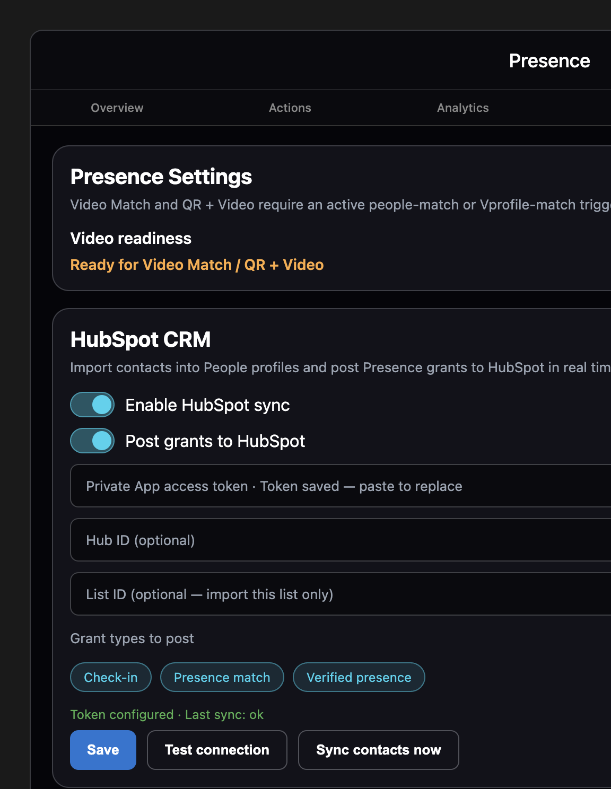

---
software_ref:
  platform_version: "2.25.101"
  policy_revision: "2026-10-18"
  channels_documented:
    - sandbox
    - pilot
    - stable
  install_path: "windows-docker-desktop-ghcr"
  host_ram_gb: 16
  wsl_memory_gb: 12
title: Presence and attendance
audience: owner-admin
nav_order: 50
---

# Presence And Attendance

Run presence check-in and attendance flows (QR, camera, or both), manage people profiles, assign a platform camera for Actions, confirm video readiness in Settings, and review session outcomes.

**Where:** Home → **Presence** (`/presence`)

## Prerequisites

- Bootstrap completed; you can log in as owner or admin
- For camera-backed flows: at least one camera online — see [Cameras and detection](./cameras-and-detection.md)
- For phone-side Presence, pick the app that matches the job:
  - **EyeNet Mobile Camera** — registers as a streaming camera **and** runs Presence controls on the live feed — see [Add a mobile camera](./cameras-and-detection.md#add-a-mobile-camera)
  - **EyeNet Authenticator** (sandbox / pilot) — Presence grants only; **not** a cameras-console device — see [EyeNet Authenticator](./presence-authenticator.md)
- For known-person matching: an **Individual Group** with members — see [Detections, individuals and persons](./detections-individuals-persons.md)
- For console / Mobile Camera **Video Match** / **QR + Video**: an active Vradar trigger in **People match** (`ppl_match`) or **Vprofile match** (`vprofile_match`) with camera(s), group(s), and a Presence action — see [Alerts and automation](./alerts-and-automation.md)
- Instant detection on the trigger’s camera when using those video paths

## Session modes (basics)

| Mode (UI / API) | Meaning |
|---|---|
| **QR Only** (`qr_only`) | Check-in via QR (station QR or owner identity QR) |
| **Camera Only** (`camera_only`) | Face / people match via a ready match trigger + Presence action (UI: **Video Match**) |
| **QR + Camera** (`qr_plus_camera`) | Owner QR on the platform camera first, then camera verification for higher assurance |

Outcomes you will see on sessions: **granted**, **denied**, **pending**, **failed**, **retry_required**, plus grant-type and assurance labels from policy.

---

## Screen layout

Six tabs on **Presence**:

| Tab | Purpose |
|---|---|
| **Overview** | Totals and recent sessions |
| **Actions** | Assign platform camera; Render QR, Video Match, Scan Owner QR, Scan Owner QR + Video |
| **Analytics** | User/day awards; outcomes and client-origin donuts; failure/policy bars; mode success; session-mode and grant-type bars |
| **Sessions** | Paginated session list, filters (incl. origin / failure / policy), download, detail inspector |
| **People** | Presence people profiles (name, email, phone, …) |
| **Settings** | Video readiness report and HubSpot CRM connection (camera assignment is on **Actions**) |

Refresh the dashboard with pull-to-refresh where available, or by leaving and re-entering Presence. The app bar **Refresh** button does the same.

**Overview** is selected when you open Presence. The cyan underline is the selected tab. **Refresh** is the circular arrow. **Home** is the house icon.

---

## Settings (video readiness)

**Tab:** **Settings** → **Presence Settings**

Video-backed buttons on the **console** and **EyeNet Mobile Camera** paths (**Video Match**, **Scan Owner QR + Video**) stay disabled until Settings reports green.

**EyeNet Authenticator** video modes do **not** use this readiness gate. They grant after a live face verify against the user’s enrolled MVR (and linked people). Details: [EyeNet Authenticator](./presence-authenticator.md).

### What “ready” means

At least one **active** trigger must satisfy all of:

1. Mode is **People match** (`ppl_match`) or **Vprofile match** (`vprofile_match`)
2. One or more cameras are bound on the trigger
3. One or more individual groups are bound on the trigger
4. An attached action that Presence accepts (action type `presence_*`, name starting with **Presence Action**, or log config with `category` / tags `presence`)

Camera reservation under **Actions** is still used for **Scan Owner QR** (platform decode). Video grants themselves come from the match trigger’s Presence action when detection fires.

### Using the report

1. Open **Settings**.
2. Under **Video readiness**, confirm **Ready** (lists qualifying trigger names) or **Not ready** (checklist of missing steps).
3. If not ready, open **Triggers**, create/fix the match trigger + Presence action, ensure instant detection is running, then pull-to-refresh Settings.

This is the **Not ready** report when no people-match or Vprofile-match trigger exists. The card text is the report message. Other missing-step cards appear when a match trigger exists but is inactive, or is missing a camera, a group, or a Presence action. **Ready** replaces the warning with a green check, **Ready for Video Match / QR + Video**, and the qualifying trigger names.

QR-only flows (**Render QR**, **Scan Owner QR**) do not require this readiness report.

### HubSpot CRM

**Tab:** **Settings** → **HubSpot CRM** (owner / admin)

Connect HubSpot so Presence can import contacts into **People** profiles and post grants onto the matching HubSpot contact in real time. Use a **Service Key** in the same HubSpot account as your contacts (HubSpot’s replacement for legacy Private Apps).

**Before you start (in HubSpot):**

1. Open **Development** → **Keys** → **Service keys** (or **Settings** → **Integrations** → **Service Keys**).
2. **Create service key** with scopes at least: `crm.objects.contacts.read`, `crm.objects.contacts.write`. For grant **Notes** and auto-created `last_presence_*` contact properties, also grant notes write and contact schema write (e.g. `crm.schemas.contacts.write` / notes-related scopes HubSpot shows when a call returns 403).
3. Copy the Service Key (Bearer token; often starts with `pat-…`).
4. Optionally prepare a HubSpot **list** of contacts to import (otherwise Presence imports all contacts).

**In EyeNet:**

1. Open Presence → **Settings** → **HubSpot CRM**.
2. Paste the Service Key into the access-token field, optionally set Hub ID and List ID.
3. Enable **HubSpot sync** and choose which grant types to post (`check_in`, `presence_match`, `verified_presence`).
4. **Save**, then **Test connection** (Presence tries to create contact properties `last_presence_at`, `last_presence_type`, `last_presence_session_id` when missing — needs schema scopes, or create those properties manually in HubSpot).
5. **Sync contacts now** — creates/updates Presence people profiles; HubSpot contact id is stored in **External Ref**.
6. Run a Presence grant for a synced person — HubSpot receives a **Note** on the contact plus the `last_presence_*` properties (when scopes allow).

Grant posting never blocks the Presence grant if HubSpot is unreachable; errors appear under the HubSpot status line. Re-posting the same session is skipped (idempotent).

---

## Actions (run a check-in)

**Tab:** **Actions**

### Assign a platform camera (do this first for owner-QR scan)

1. Under **Presence Camera**, find the USB / RTSP / edge camera to use for presence.
2. Tap **Reserve**. Reserving also auto-binds the linked media collection when the backend can resolve one.
3. Confirm the snackbar. A chip shows the assigned camera.
4. **Unreserve** to clear.

Example camera names only. **Front Door** is already assigned, so its row shows **Unreserve**. The marked **Reserve** on **Desk Webcam** assigns that camera instead. The cyan outline is only a marker in this figure.

Without an assigned camera, **Scan Owner QR** (and the QR step of **QR + Video**) cannot run platform decode.

Optional fields above / beside the QR panel:

| Field | Notes |
|---|---|
| **Device Display Name** | Label stored inside the QR payload (defaults differ for console vs station) |
| Location label | Optional label in the QR location payload |

### Operator buttons

| Button | Mode | What it does |
|---|---|---|
| **Render QR** | `qr_only` | Creates/reuses a session and renders a **station** presence QR. Shows under **Current QR Payload** (copyable). Mobile users scan this QR. |
| **Video Match** | `camera_only` | Starts a camera-only session when video readiness is green. Grants arrive when the match trigger’s Presence action fires. Disabled with a Settings hint when not ready. |
| **Scan Owner QR** | `qr_only` | Decodes an **owner identity** QR from the **assigned platform camera** (cameras service). Browser/webcam scanning is not used. Shows live preview for aiming when available. |
| **Scan Owner QR + Video** | `qr_plus_camera` | Same platform-camera QR decode, then camera verification. Disabled until video readiness is green. |

**Video Match** and **Scan Owner QR + Video** show **Not ready** and stay disabled until Settings reports green. **Render QR** and **Scan Owner QR** stay available. **Device Display Name** defaults to **Presence Web Console** on the console. **Location Label** is optional. After **Render QR**, **Current QR Payload** shows the station QR and a copy button. That QR is not drawn here.

### Typical flows

**A. Station QR (phone scans screen)**  
1. Actions → **Render QR** (match-group reserve in Settings is not required for QR-only).  
2. On the phone (EyeNet Mobile Camera), tap the **Scan station QR** control → **Scan Presence QR**, then point at the console QR.  
3. Watch **Overview** / **Sessions** for granted or denied (phone may also show a Presence result banner).

**B. Camera-only match**  
1. Triggers: active `ppl_match` or `vprofile_match` with camera, group, and Presence action; start [instant detection](./cameras-and-detection.md).  
2. Settings: confirm **Video readiness** is green.  
3. Actions → **Video Match** (console), **or** start camera-only Presence from the phone’s **Camera-only** control when that phone is the reserved Presence camera.  
4. Person stands in view of the trigger / reserved camera.  
5. Session completes with a decision; snackbar may show *Presence grant awarded.* on success.

**C. Owner QR at the desk**  
1. Actions: assign a platform camera (USB webcam on the host is typical).  
2. Actions → **Scan Owner QR** (or **Scan Owner QR + Video** when Settings is green).  
3. On the phone, open **User Owner QR** (badge control) and hold that QR in view of the **platform** camera (not the browser camera).  
4. On success the console submits the owner QR hit; for + Video, face verification continues via the ready match trigger path.

### Mobile camera (EyeNet Mobile Camera app)

Presence on the phone lives in the **EyeNet Mobile Camera** camera screen (same app used to register a streaming camera — see [Add a mobile camera](./cameras-and-detection.md#add-a-mobile-camera)). The lower control row has four Presence actions (icons only in the app; labels below are for this wiki):

| Control (left → right) | Opens / starts | Pairs with console |
|---|---|---|
| **Owner QR** (badge) | **User Owner QR** screen | **Scan Owner QR** / **Scan Owner QR + Video** |
| **Scan station QR** | **Scan Presence QR** (back camera) | **Render QR** station challenge |
| **Camera-only** | Camera-only Presence session | Same path as **Video Match** when this device is the reserved Presence camera |
| **QR + Video** (shield) | Scan station QR, then front-camera verification | **Scan Owner QR + Video** / verified Presence |

The cyan outlines and labels are markers in this figure only. The live preview area is a placeholder — installs show the phone camera.

#### User Owner QR (flow C)

Tap the badge control. Title: **User Owner QR**. Shows a white QR tile, the signed-in display name (or *Owner QR ready for station scan.*), and the selectable payload text. Hold this QR up to the desk **platform** camera while the console runs **Scan Owner QR**.

#### Scan Presence QR (flow A)

Tap the QR-scan control (or continue from a QR-only / verified Presence start). Title: **Scan Presence QR**. Hint: *Point the back camera at the station QR to continue Presence.*

While a QR-only session is waiting for that scan, the camera feed can show a status banner such as *Scan the station QR to complete Presence check-in.*

#### Presence result on the phone

When the session finishes, a banner can appear on the camera feed (example success: *Presence completed: granted*). Failures use a humanized reason; some paths also show a **Presence Unsuccessful** dialog. Console **Sessions** / **Overview** remain the operator-of-record list.

### Current QR / live result

- **Current QR Payload** — copy token; regenerate with **Render QR** if stale.
- When a session is active, chips may show decision, grant type, policy source, and related status.

---

## Overview

**Tab:** **Overview**

Metric cards (when summary data is loaded):

- **Total Sessions** · **Completed** · **Pending** · **Granted** · **Denied**

The dashes stand in for the live counts.

When summary data is loaded, each card shows a count: **Total Sessions**, **Completed**, **Pending**, **Granted**, **Denied**. The numbers in this figure (13, 11, 2, 8, 3) are examples.

**Recent Sessions** — latest operator-readable session cards. Tap a card to open the **session inspector**.

Each card is one session. The title is the session headline, or the fallback *interaction for actor is status.* The line under it is the time, then the actor email when the service sends one. Chips are the decision (**Granted**, **Denied**, **Failed**, **Retry Required**, or **Pending**), the interaction (**QR**, **Cam**, or **Cam & QR**), and the camera label when there is one. **desk@example.com**, **Front Door**, and the times are examples. This module does not show a video frame or a face.

---

## Analytics

**Tab:** **Analytics**

Use this tab after a pilot day to answer: who checked in, how, from which client, and why attempts failed.

### Layout (top → bottom)

1. **Analytics range** — Start / End dates for the summary cards and distribution sections below (independent of the awards date pickers until you click through).
2. **User-Day Presence Awards** — filter by user and date; expand a row to load granted sessions for that day; chips such as **QR**, **Cam**, **Cam & QR** / QR-to-cam transition filters.
3. **Summary cards** — Total · Completed · Pending · Granted · Denied · **Failed** · **Expired** (expired counts sessions with reason `presence_session_expired`).
4. **Outcomes** and **Client Origin** — donut charts (share of the selected range). Legend rows are the primary click targets.
5. **Failure Reasons** — horizontal bars of `failure_reason_code` values (expires, attempt limits, face mismatch, …).
6. **Policy Sources** — bars such as `authenticator_mvr_verify`, `platform_trigger`, `default_policy`.
7. **Mode Success Rate** — per mode: granted / total, fail rate, expire rate.
8. **Session Modes** and **Grant Types** — usage bars (`qr_only` / `camera_only` / `qr_plus_camera` and grant labels from the service).

**User-Day Presence Awards** stays at the top (just under the analytics range). **User**, **Apply**, **Start**, and **End** filter the awards. **QR**, **Cam**, and **Cam & QR** appear on an expanded row. The dates are examples.

Each bar row is a label, a count, and a bar. **Session Modes** uses **QR Only**, **Camera Only**, and **QR + Camera**. **Grant Types** uses the labels returned by the presence service; the keys in this figure (`check_in`, `presence_match`, `verified_presence`) are examples. An empty section reads **No data available yet.**

### Click-through to Sessions

Tap a summary card, donut legend item (or wedge), failure/policy/mode bar, or mode-success row to open the **Sessions** tab with matching filters and the same date range. Examples:

- **Failed** → Decision: Failed  
- **Expired** → Failure: `presence_session_expired`  
- **Client Origin → Authenticator** → Origin: authenticator  

---

## Sessions

**Tab:** **Sessions**

Paginated list: *All presence sessions with server-side pagination and filtering.*

### Filters

| Control | Purpose |
|---|---|
| **User** | Free-text user filter |
| Date range | From / to pickers |
| Filter sheet | Multi-select chips by category |

Filter categories include:

- **Grant** (grant types from analytics)
- **Mode** — QR Only · Camera Only · QR + Camera
- **Decision** — Granted · Denied · Pending · Failed · Retry Required
- **Policy** — e.g. `authenticator_mvr_verify`, `platform_trigger`, `default_policy`
- **Failure** — `failure_reason_code` values (e.g. `presence_session_expired`)
- **Origin** — `authenticator` · `mobile_camera` · `console` · `station` · `trigger` · …
- **Camera** · **Group** · **Member** · **Profile**

Apply filters, clear chips, and page through results. **Download Excel** exports the filtered sessions to a workbook (columns include session UUID, times, mode, decision, grant type, QR status, and related identity fields).

**User** searches email, username, or id. **Filters** opens the dialog below. **Start** and **End** are the date pickers. The dates and the **Mode: QR Only** chip are examples. **Clear all** removes every chip. The export button label is **Download Excel**.

The title shows how many filters are active. Each row is a checkbox; the subtitle is the category (**Mode**, **Decision**, **Policy**, **Failure**, **Origin**, and also **Grant type**, **Camera**, **Group**, **Member**, **Profile** when those options exist). **Apply** keeps the checked rows. **Clear** empties the selection inside the dialog.

### Session inspector

Tap a session card. Detail panels typically include:

| Section | Contents |
|---|---|
| **Session** | Mode, assurance, grant type, status, decision, QR status, detection status, camera, matched member / group / demographics when present |
| **Action Plan** | Planned steps and policy source |
| **Decision History** | Decision + reason code trail |
| **Audit Log** | Operator-readable audit entries |

Use **reason code** on denied / failed rows when troubleshooting policy or match failures.

The chips are example status words, not a live session, and no person name is shown. **Action Plan** rows include Policy Source, Trigger Type, Action Type, and Execution Status. An empty **Decision History** reads **No decision history recorded.** When a decision exists, the row title is the decision and the subtitle is the reason code.

---

## People (presence profiles)

**Tab:** **People**

Presence **people profiles** represent a person across presence activity (separate from Individual Group membership, though they can be linked by matching).

1. Tap **New Profile** → dialog title **New People Profile**.
2. Fill:

| Field | Required |
|---|---|
| **Name** | Yes |
| **Email** | Optional |
| **Phone** | Optional |
| **External Ref** | Optional |
| **Notes** | Optional |

3. **Save**. Search profiles from the search box.  
4. Edit or **Delete** from the profile card (delete asks for confirmation).

Empty state: *No people profiles yet. Create one to represent a person across groups.*

**New Profile** opens the dialog. The cyan outline is only a marker in this figure. **Sync with user accounts** links profiles to platform user accounts. **Search profiles** matches name, email, phone, or external ref.

**Name** is required. **Front Desk** is an example name. Email, phone, external ref, and notes are optional. **Save** stores the profile. Editing a card uses the same dialog titled **Edit People Profile**.

---

## Recommended setup order

1. [Cameras](./cameras-and-detection.md): add camera, connect, start instant detection.  
2. [Individual Groups](./detections-individuals-persons.md): create group, add members.  
3. [Triggers](./alerts-and-automation.md): create an active People match or Vprofile match trigger with that camera + group and a Presence action.  
4. Presence → **Actions**: **Reserve** the platform camera for owner-QR decode.  
5. Presence → **Settings**: confirm **Video readiness** is green.  
6. Presence → **People**: create profiles if you track email/phone externally.  
7. Presence → **Actions**: run **Video Match**, **Scan Owner QR**, or **Render QR** as a dry run.  
8. Phone: dry-run with **EyeNet Mobile Camera** (**User Owner QR** / **Scan Presence QR**) and/or **EyeNet Authenticator** (enroll once, then Scan station QR / Video match) — see [EyeNet Authenticator](./presence-authenticator.md).  
9. Presence → **Sessions**: open the inspector and confirm granted / denied + reason (and Origin when relevant).  
10. Presence → **Analytics**: confirm Outcomes / Client Origin / session mode buckets moved.

## What good looks like

- Settings **Video readiness** is green and lists the qualifying trigger(s) (for console / Mobile Camera video)  
- Actions shows the assigned platform camera for owner-QR decode  
- Video Match / QR + Video are enabled only when readiness is green  
- Actions produce a QR payload or a live session without errors  
- Overview granted/completed counts increase after a successful test  
- Session inspector shows decision, grant type, and (for matches) member/group chips  
- Denied / failed sessions carry a readable reason code  
- Analytics can separate **Authenticator** origin from console / mobile camera / trigger  

## Related

- [EyeNet Authenticator](./presence-authenticator.md) — phone Presence without a cameras-console device (sandbox / pilot)
- [Cameras and detection](./cameras-and-detection.md)
- [Detections, individuals and persons](./detections-individuals-persons.md)
- [Vradar — alerts and automation](./alerts-and-automation.md)
- [User management](./users-and-roles.md)
- [Entrances and activity](./entrances-and-activity.md) — traffic analytics, not presence sessions
