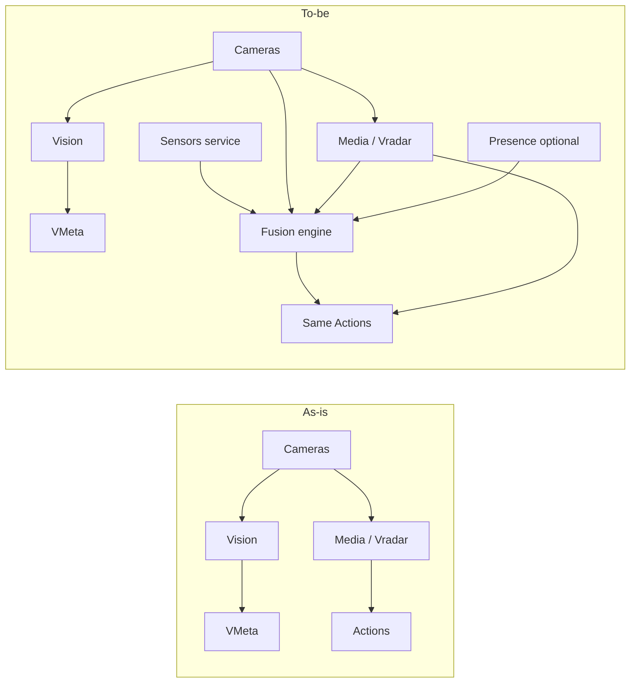
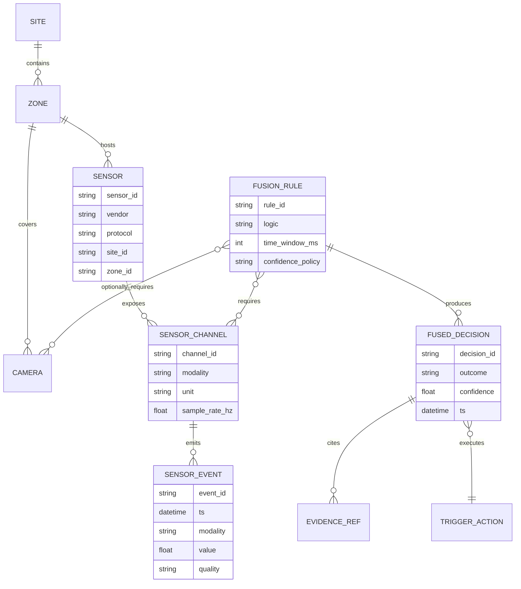
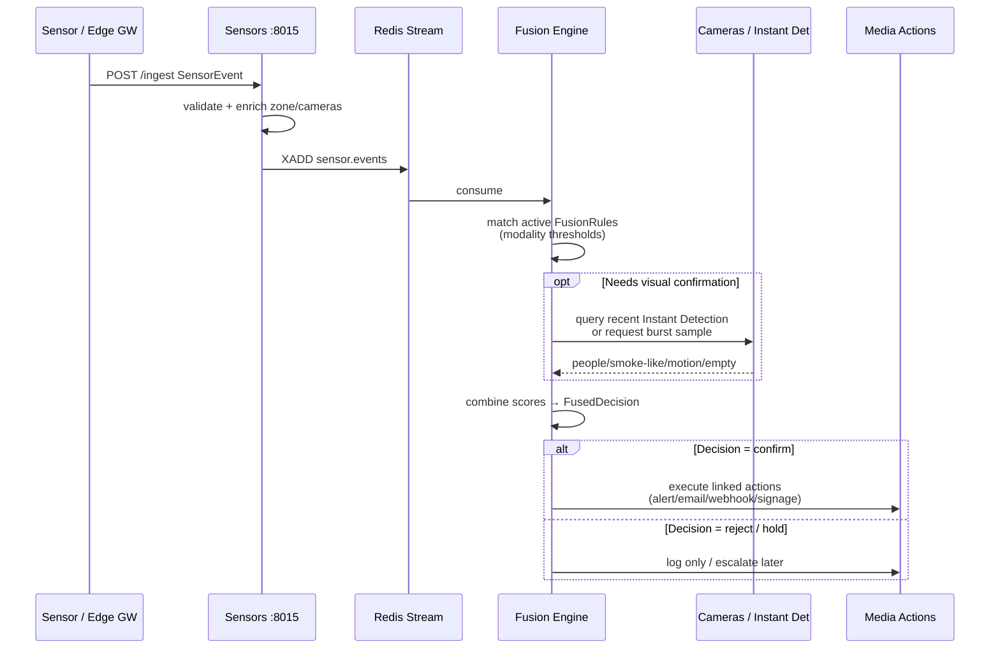

# Multimodal Sensing & Sensor Fusion Extension

## Embedding Non-Camera Sensors into the EyeNet Platform

**Status**: Proposal  
**Date**: November 11, 2026  
**Author**: PPL Meta Platform Team  
**Printable HTML**: [multimodal-sensor-fusion-extension.html](./multimodal-sensor-fusion-extension.html) (Mermaid sketches + Chart.js roadmap)  
**Related**: Instant Detection event path · Media / Vradar triggers · Presence correlation · Talos IoMT cooperation notes · Fire-detect commercial fusion language

---

## 1. Executive Summary

EyeNet today is a **camera- and computer-vision–centric** platform. It already performs **within-vision multimodality** (face ↔ body merge, objects/plates, multi-camera CV triggers) and limited **identity correlation** (QR/NFC + optional camera for Presence). It does **not** yet ingest arbitrary physical sensors (temperature, smoke, gas, IMU, door contacts, radar, IoMT telemetry, etc.) or fuse them with video evidence under shared rules.

This proposal defines how to **develop and embed a multimodal sensing / sensor-fusion extension** without rewriting the vision stack:

1. Add a first-class **Sensors** domain (registry + ingest adapters + normalized events).
2. Add a **Fusion / Correlation** layer that joins sensor events with camera / Instant Detection / Presence context by **time + place + rule**.
3. Reuse the existing **Media / Vradar action path** (alert, email, webhook, signage, log) as the egress for fused decisions.
4. Expose the capability through **Gateway + Frontend** as a natural extension of Automation, not a parallel product silo.

**Design principle:** treat video as *one modality among many*, while keeping Cameras → Vision → VMeta as the authoritative path for visual evidence.

---

## 2. Goals and Non-Goals

### 2.1 Goals

- Ingest heterogeneous sensor inputs via pluggable adapters (HTTP webhook first; MQTT / vendor APIs next).
- Normalize all inputs into a common **SensorEvent** envelope (identity, site/zone, timestamp, type, value, quality).
- Correlate sensor streams with **camera FOV / site topology** and optional CV detections.
- Fire fused automations through existing **Vradar actions**.
- Preserve on-prem / VPN-first deployment; no cloud dependency for core fusion.
- Support commercial use cases already described externally (thermal×optical confirmation, IoMT×vision, industrial threshold + camera verify) as **platform capability**, not one-off scripts.

### 2.2 Non-Goals (Phase 1–2)

- Replacing `cameras` with a single polymorphic “device” table that breaks existing APIs.
- Building proprietary low-level drivers for every vendor protocol in v1.
- Deep ML late-fusion models as the default (start with deterministic rules + confidence scoring).
- Storing raw high-rate waveform dumps as first-class media (keep time-series compact; attach clips only when fusion fires).
- Mandatory coupling to any single partner stack (Talos, fire OEM, BMS); partners plug in via adapters.

---

## 3. Current System (Baseline)

### 3.1 Camera-centric pipeline today

```
┌────────────┐   frames    ┌────────────┐  detections  ┌────────────┐
│  Cameras   │────────────▶│   Vision   │─────────────▶│   VMeta    │
│  :8005     │             │   :8003    │              │   :8008    │
└─────┬──────┘             └────────────┘              └─────┬──────┘
      │ instant webhook / Redis                              │
      ▼                                                      │
┌────────────┐  triggers / actions                    ┌──────▼──────┐
│   Media    │◀───────────────────────────────────────│ Orchestrator│
│  Vradar    │         (recording / batch path)       │   :8002     │
│   :8000    │                                        └─────────────┘
└─────┬──────┘
      │ alert / email / webhook / signage
      ▼
┌────────────────┐
│ Communications │
└────────────────┘
```

### 3.2 What already looks like “fusion”

| Capability | Nature | Limit |
|---|---|---|
| Face ↔ Body analytics merge | Vision-only spatial/temporal merge | Same camera / video domain |
| Multi-mode Vradar triggers | CV fields on Instant Detection | Bound to `camera_device_id`(s) |
| Presence QR/NFC + camera | Identity cue + optional visual assurance | Not a general sensor bus |
| Commercial “sensor fusion” copy | Thermal + optical product narrative | Not a platform ingest/fusion service |

### 3.3 Embedding constraint

Media triggers and Instant Detection webhooks assume **camera identity + CV-derived fields**. Extending fusion means **widening the event vocabulary**, not replacing Vision.

---

## 4. Target Architecture

### 4.1 High-level: Sensors as a peer domain, Fusion as the join

```
                        ┌──────────────────────────────────────────────┐
                        │                 Gateway :8001                 │
                        │  /api/v1/sensors/*  /api/v1/fusion/*          │
                        │  existing /cameras  /cameras  /presence ...  │
                        └───────────┬───────────────────┬──────────────┘
                                    │                   │
              ┌─────────────────────▼──────┐   ┌────────▼──────────────┐
              │   NEW: ppl-meta-sensors     │   │ Existing EyeNet stack  │
              │   :8015 (proposed)          │   │ Cameras / Vision /     │
              │                             │   │ VMeta / Media / Node   │
              │  • Sensor registry          │   │ Presence / Comms       │
              │  • Ingest adapters          │   └────────┬──────────────┘
              │  • Normalized SensorEvent   │            │ vision events
              │  • Time-series store        │            │ (Instant Detection)
              └─────────────┬───────────────┘            │
                            │ SensorEvent bus            │
                            └──────────┬─────────────────┘
                                       ▼
                        ┌──────────────────────────────┐
                        │  NEW: Fusion / Correlation    │
                        │  (module in Media Phase 1,    │
                        │   optional service Phase 3)   │
                        │                              │
                        │  Rules: time ∩ zone ∩        │
                        │  modality conditions         │
                        │  → FusedDecision             │
                        └──────────────┬───────────────┘
                                       │
                                       ▼
                        ┌──────────────────────────────┐
                        │  Media Vradar action runner  │
                        │  alert · email · webhook ·   │
                        │  signage · log               │
                        └──────────────────────────────┘
```

### 4.2 Recommended service split

| Component | Placement | Rationale |
|---|---|---|
| **Sensor registry + ingest** | New microservice `ppl-meta-sensors` | Keep Cameras free of non-video protocols; clear ownership |
| **Fusion engine (v1)** | Module inside **Media** next to trigger evaluation | Reuses action execution, auth patterns, audit logs with minimal new surface |
| **Fusion engine (v2+)** | Optional extract to `ppl-meta-fusion` if load / partner isolation requires it | Same contracts; move without rewriting rules |
| **Gateway routes** | Proxy `/sensors` and `/fusion` | Consistent client access |
| **Frontend** | Sensors inventory + Fusion rules under Automation | Operators already know Vradar UX |

**Local-first development principle** (same as other platform proposals): implement as local Python services first; Docker packaging follows verified end-to-end behavior.

---

## 5. Architectural Drawings

### 5.1 As-is vs to-be context



### 5.2 Logical domain model



### 5.3 Ingest adapter architecture

```
                    ┌─────────────────────────────────────┐
                    │         ppl-meta-sensors             │
                    │                                     │
   MQTT broker ───▶ │  Adapter: mqtt_subscribe            │
   HTTP POST   ───▶ │  Adapter: http_ingest  (/ingest)    │──▶ SensorEvent
   Vendor API  ───▶ │  Adapter: poll_connector (worker)   │     (normalized)
   Modbus/BACnet ─▶ │  Adapter: industrial (Phase 3+)     │
   Edge gateway ─▶ │  Adapter: edge_forwarder             │
                    │                                     │
                    │  Validation → AuthN/Z → Enrichment  │
                    │  (site/zone/camera links)           │
                    │                                     │
                    │  Persist: events + downsampled TS   │
                    │  Publish: Redis stream / pub-sub    │
                    └─────────────────────────────────────┘
```

**v1 adapters (ship first):**

1. **HTTP ingest webhook** — partners and edge gateways push JSON.
2. **Manual / simulator** — for lab and CI.
3. **Internal bridge** — map selected Presence / door / NFC events into SensorEvent (optional).

**v2+ adapters:** MQTT, OPC-UA/BACnet, partner IoMT REST, thermal camera metadata side-channel (non-frame).

### 5.4 Normalized SensorEvent envelope

```json
{
  "event_id": "sev_01J...",
  "sensor_id": "smoke_lobby_01",
  "channel_id": "smoke_ppm",
  "modality": "smoke",
  "ts": "2026-11-11T15:04:22.131Z",
  "value": { "numeric": 1.8, "unit": "ppm", "state": null },
  "quality": "good",
  "site_id": "inst_uuid",
  "zone_id": "zone_lobby",
  "linked_camera_ids": ["rtsp_192.168.1.80_554"],
  "provenance": {
    "adapter": "http_ingest",
    "vendor": "acme",
    "raw_ref": "optional opaque id"
  },
  "attrs": { "battery_pct": 91 }
}
```

Modalities are an extensible enum, e.g. `temperature | humidity | smoke | gas | contact | imu | radar | iomt_vitals | thermal_alarm | custom`.

### 5.5 Fusion / correlation sequence



### 5.6 Embedding into Vradar (trigger extension)

Do **not** invent a second automation product. Extend Media triggers:

| Extension | Behavior |
|---|---|
| New `trigger_mode`: `sensor_fusion` | Evaluates multi-source conditions |
| `fusion_conditions` JSON | Sensor predicates + optional CV predicates |
| `fusion_window_ms` | Temporal join window (e.g. 5–60s) |
| `fusion_logic` | `and` / `or` / weighted score |
| `evidence_policy` | `sensors_only` \| `require_camera` \| `prefer_camera` |
| Existing `action_uuids` | Unchanged egress |

Example rule (conceptual):

```json
{
  "trigger_mode": "sensor_fusion",
  "name": "Lobby fire confirm",
  "fusion_window_ms": 15000,
  "fusion_logic": "and",
  "evidence_policy": "require_camera",
  "fusion_conditions": [
    { "source": "sensor", "modality": "smoke", "operator": "gte", "value": 1.0 },
    { "source": "sensor", "modality": "temperature", "operator": "gte", "value": 55 },
    { "source": "vision", "field": "motion_or_anomaly", "operator": "eq", "value": true }
  ],
  "zone_id": "zone_lobby",
  "linked_camera_device_ids": ["rtsp_lobby_thermal", "rtsp_lobby_optical"],
  "action_uuids": ["...alert...", "...webhook..."]
}
```

Thermal × optical commercial narrative becomes a **specialization** of the same rule engine (two vision channels and/or thermal alarm channel + optical CV), not a separate codebase.

### 5.7 Deployment topology (on-prem installation)

```
┌────────────────────── Installation host / edge box ──────────────────────┐
│                                                                          │
│  Gateway ──▶ Cameras Vision VMeta Media Orchestrator Node Presence Comms │
│                 ▲                                                        │
│                 │ Redis / internal HTTP                                  │
│                 │                                                        │
│            Sensors svc ──▶ Fusion module (in Media)                      │
│                 ▲                                                        │
│                 │ LAN / VPN                                              │
│                                                                          │
│  ┌────────── local IoT ──────────┐   ┌──────── cameras ────────┐         │
│  │ smoke · temp · door · IMU     │   │ RTSP / USB / mobile     │         │
│  │ MQTT broker or HTTP push      │   └─────────────────────────┘         │
│  └───────────────────────────────┘                                       │
└──────────────────────────────────────────────────────────────────────────┘
```

Sensors never need to traverse the public internet; same VPN story as cameras.

### 5.8 Evidence & provenance for a fused alert

```
FusedDecision
├── outcome: confirmed | rejected | inconclusive
├── confidence: 0.0–1.0
├── rule_id / rule_version
├── sensor_evidence[]
│     └── event_id, modality, value, ts, sensor_id
├── vision_evidence[]
│     └── camera_id, flush/span ref, clip/thumbnail ref, detection summary
├── presence_evidence[] (optional)
└── actions_executed[]
```

This makes commercial claims (“confirmed only when both channels agree”) auditable in product, not only in brochure text.

---

## 6. API Surface (Sketch)

### 6.1 Sensors service

| Method | Path | Purpose |
|---|---|---|
| `POST` | `/api/v1/sensors` | Register sensor |
| `GET` | `/api/v1/sensors` | List / filter by site, zone, modality |
| `PATCH` | `/api/v1/sensors/{id}` | Update links (zone, cameras) |
| `POST` | `/api/v1/sensors/ingest` | Push SensorEvent (adapter auth) |
| `GET` | `/api/v1/sensors/{id}/events` | Recent events |
| `GET` | `/api/v1/sensors/{id}/timeseries` | Downsampled series |
| `GET` | `/api/v1/health` | Liveness |

### 6.2 Fusion (Media-hosted v1)

| Method | Path | Purpose |
|---|---|---|
| `POST` | `/api/v1/fusion/rules` | Create fusion rule / `sensor_fusion` trigger |
| `GET` | `/api/v1/fusion/rules` | List |
| `POST` | `/api/v1/fusion/evaluate` | Dry-run / sim |
| `GET` | `/api/v1/fusion/decisions` | Decision history + evidence |
| Internal | Redis consumer | Live evaluation loop |

Gateway mirrors these under the same paths with existing auth.

---

## 7. Data Storage

| Store | Contents | Notes |
|---|---|---|
| Sensors DB (Postgres) | sensors, channels, zone links, adapter credentials refs | Prefer secrets vault pattern already used elsewhere |
| Events table + retention policy | Recent SensorEvents | Hot window (e.g. 7–30 days) |
| Time-series (Postgres hypertables **or** Redis TS / simple rollups) | Aggregates for UI charts | Avoid overbuilding in v1 |
| Media DB | fusion rules (or extended `triggers`), decision logs | Align with `trigger_execution` audit style |
| Object / media storage | Optional clip/thumbnail refs when vision evidence attached | Reuse existing media paths |

---

## 8. Security, Privacy, and Tenancy

- Adapter credentials are **installation-scoped**; ingest tokens are rotatable and least-privilege (`ingest` only).
- Sensor payloads may include health/IoMT data — apply same **purpose limitation** and role capabilities as Presence / demographics; add capability flags e.g. `sensors:read`, `sensors:ingest`, `fusion:manage`.
- Fused alerts must show **provenance** so operators can distinguish sensor-only vs camera-confirmed decisions.
- No cross-installation sensor mesh by default; Matrix/VPN sharing is an explicit Phase 4 concern.

---

## 9. Phased Delivery Plan

### Phase 0 — Foundations (1–2 weeks)

- Domain model + JSON schemas for SensorEvent / FusionRule / FusedDecision.
- Threat model and capability flags.
- Simulator producing smoke/temp/contact events.

### Phase 1 — Sensors service + HTTP ingest (3–5 weeks)

- `ppl-meta-sensors` skeleton (FastAPI), registry CRUD, ingest endpoint, Redis publish.
- Gateway proxy + basic Frontend inventory screen.
- Zone ↔ camera linking (manual mapping UI).

### Phase 2 — Fusion embedded in Media / Vradar (4–6 weeks)

- `trigger_mode=sensor_fusion` + condition evaluator.
- Temporal join window; `require_camera` evidence policy calling Instant Detection recent state or on-demand sample.
- Decision log with evidence refs; reuse existing actions.
- One reference playbook: **smoke + temp + camera motion/occupancy**.

### Phase 3 — Adapters & vertical packs (ongoing)

- MQTT adapter; industrial connectors as needed.
- Thermal alarm side-channel + optical CV confirmation pack (aligns fire-detect commercial story).
- IoMT / partner webhook pack (aligns Talos-style cooperation without hard dependency).
- Optional extract Fusion to standalone service if Media load warrants it.

### Phase 4 — Hardening & analytics

- Fusion analytics dashboards (false-confirm rate, latency, modality contribution).
- Rule versioning, A/B dry-run, chaos tests for clock skew.
- Multi-site Matrix sharing policies (if product requires).

---

## 10. Implementation Touchpoints (Where to Embed)

| Area | Change |
|---|---|
| **New** `ppl-meta-sensors/` | Service package (models, adapters, API, workers) |
| **Media** `trigger.py` + evaluation | Add `sensor_fusion` mode + fusion_conditions |
| **Media** demographic_triggers / webhook path | Accept fusion-originated action execution (internal) |
| **Cameras** | Optional “burst on fusion request” API for evidence |
| **Gateway** | Route registration for sensors/fusion |
| **Frontend** | Sensors page; Automation rule builder multimodal conditions |
| **Node / auth** | Capabilities for sensors & fusion |
| **Docs / wiki** | Owner guide: Sensors + Fusion; update Vradar page |
| **Commercial** | Re-home “sensor fusion engine” claims onto this architecture |

**Explicit non-touch:** do not overload Vision to parse MQTT or store temperature series. Vision stays frame-in / detection-out.

---

## 11. Example End-to-End Flows

### 11.1 Industrial threshold + camera verify

1. Temp sensor in Zone A exceeds 70°C → SensorEvent.
2. Fusion rule matches zone + threshold; `evidence_policy=require_camera`.
3. Fusion queries Instant Detection on linked camera — sees no person / or sees smoke-like motion (depending on rule).
4. On confirm → webhook to BMS + in-app alert with dual evidence.

### 11.2 Access / door contact + Presence + camera

1. Door contact opens off-hours → SensorEvent `contact=open`.
2. Presence has no valid QR session in zone.
3. Camera Instant Detection shows person → fused “unauthorized entry” decision.
4. Action: alert + signage message + optional recording start via Cameras API.

### 11.3 Thermal × optical fire confirmation (product narrative)

1. Thermal channel alarm or thermal CV detection → SensorEvent and/or vision event.
2. Optical camera CV must also meet smoke/flame-like condition within window.
3. Decision confirmed only on AND; otherwise log as rejected candidate (false-alarm suppression).

---

## 12. Risks and Mitigations

| Risk | Mitigation |
|---|---|
| Clock skew across devices | NTP guidance; configurable windows; store both device_ts and ingest_ts |
| Adapter sprawl | Strict SensorEvent contract; adapters are thin; reject raw vendor JSON at fusion layer |
| Overloading Media | Phase 1 module OK; extract service if consumer lag grows |
| Privacy expansion (IoMT) | Separate modalities + capabilities; default deny in UI packs |
| Mapping sensors to cameras poorly | Force zone topology; warn when rule lacks linked cameras under `require_camera` |
| Expectation mismatch with brochures | Ship Phase 2 reference playbook before external fusion claims |

---

## 13. Success Metrics

- Time from SensorEvent ingest → FusedDecision p95 &lt; 2s for sensor-only rules; &lt; 5–8s when camera evidence requested.
- ≥1 production-ready adapter (HTTP) + ≥1 vertical playbook.
- Zero regression on existing Instant Detection / demographic / behavioural triggers.
- Operator can create a fused rule in Automation UI without CLI.
- Decision audit includes modality provenance for 100% of fused alerts.

---

## 14. Open Questions

1. **Port allocation:** confirm `:8015` (or next free) for Sensors in the local service map.
2. **Zone model source of truth:** extend an existing site/collection concept vs new `zones` table in Sensors.
3. **Camera evidence API:** reuse latest Instant Detection Redis snapshot vs explicit “fusion burst sample” to Cameras.
4. **IoMT data residency:** same installation DB vs encrypted quarantine schema for health modalities.
5. **Whether thermal video is a Camera (Vision) or a Sensor channel** — recommendation: **Camera for frames**; optional **Sensor channel for vendor thermal alarms / spot temps** so fusion can AND them cleanly.

---

## 15. Recommendation

Proceed with a **peer Sensors service + Media-embedded Fusion engine** that:

- keeps the vision pipeline intact,
- reuses Vradar actions,
- makes commercial multimodal claims implementable and auditable,
- and grows adapters per vertical without forking Automation.

Phase 0–2 delivers a credible platform extension; Phase 3+ monetizes vertical packs (fire confirm, industrial BMS, IoMT cooperation) on the same spine.

---

## Appendix A — Component checklist

- [ ] SensorEvent / FusionRule / FusedDecision schemas
- [ ] `ppl-meta-sensors` FastAPI service + Postgres models
- [ ] HTTP ingest adapter + simulator
- [ ] Redis stream `sensor.events`
- [ ] Media `sensor_fusion` trigger mode
- [ ] Fusion evaluator + decision log
- [ ] Gateway routes + capabilities
- [ ] Frontend: Sensors inventory + Fusion rule builder
- [ ] Reference playbook docs (smoke/temp/camera)
- [ ] Retention & security review

## Appendix B — Glossary

| Term | Meaning |
|---|---|
| **Modality** | Kind of measurement (smoke, temp, vision face, vision body, contact, …) |
| **SensorEvent** | Normalized observation from a non-video (or side-channel) source |
| **Fusion rule** | Temporal + logical join across modalities producing a decision |
| **Evidence policy** | Whether camera/Presence confirmation is required, preferred, or optional |
| **Vradar** | Existing Automation product surface for triggers/actions |
| **Within-vision multimodality** | Face/body/object fusion already in analytics — not this extension’s primary scope |
